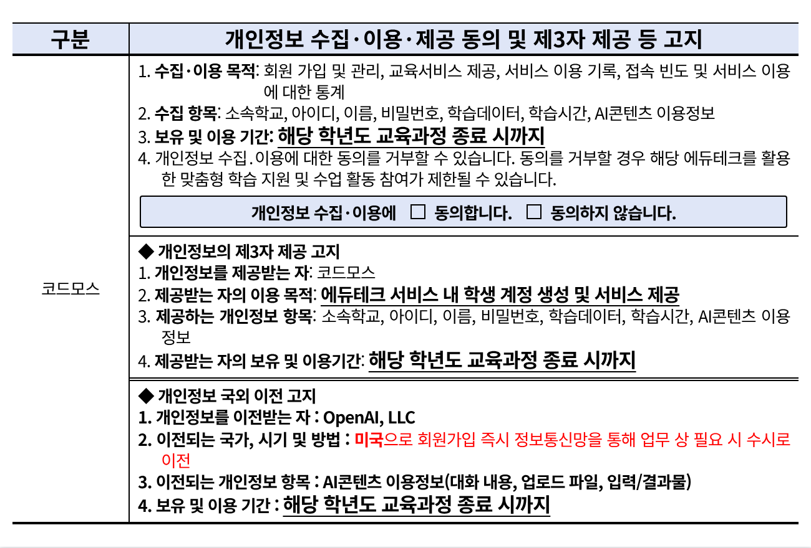
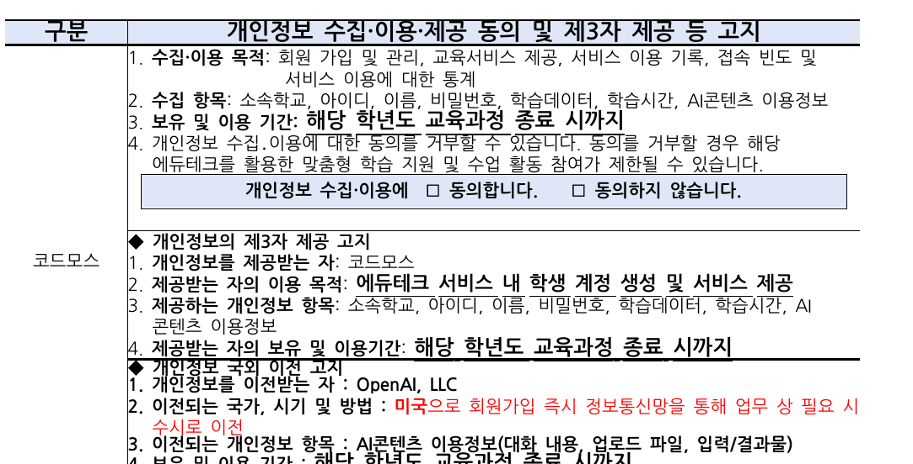
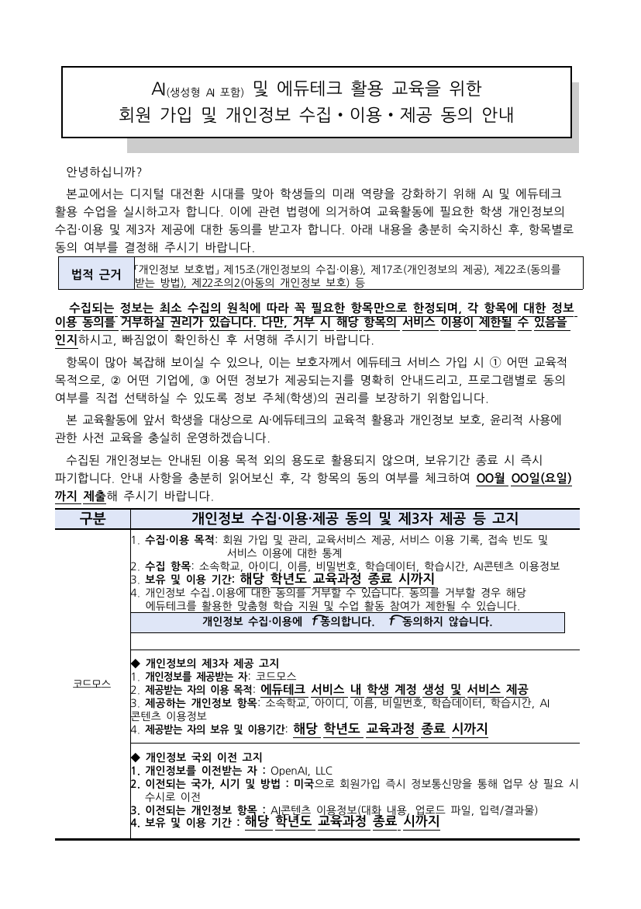
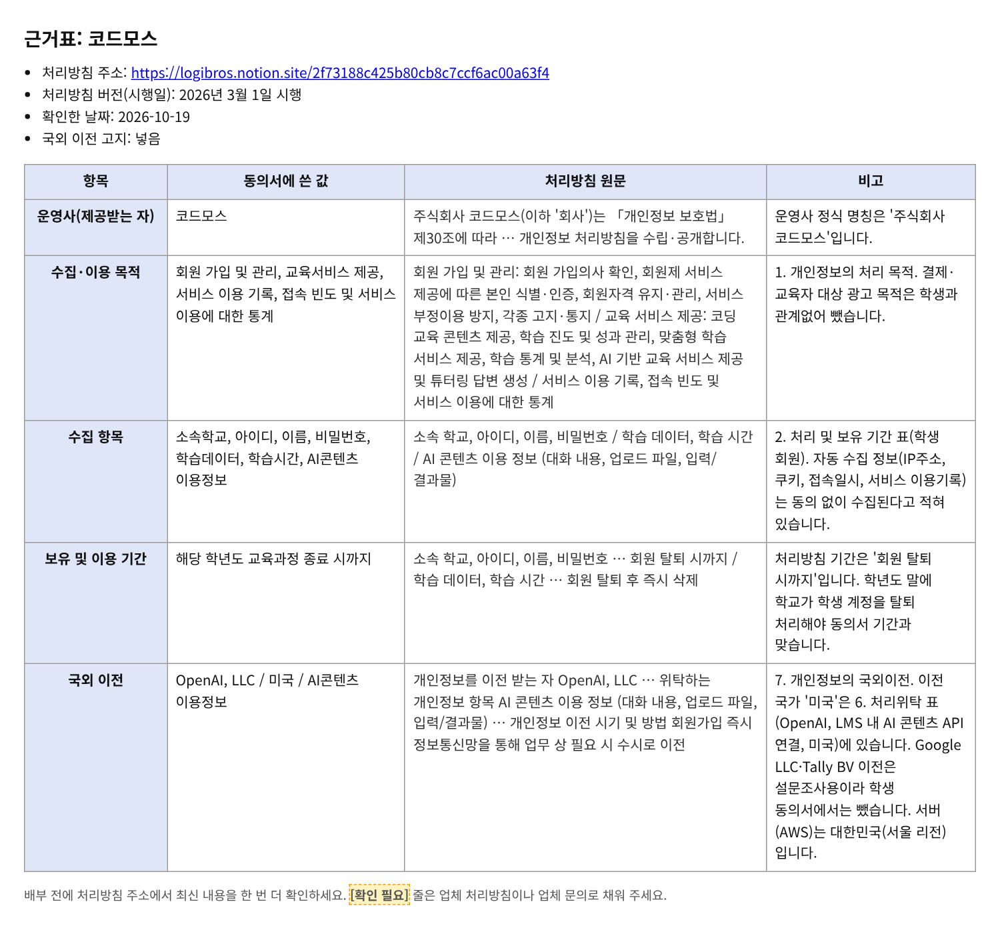

# edu-consent-form · 에듀테크 개인정보 동의서 양식 만들기

에듀테크(AI 포함) 서비스의 **개인정보처리방침**을 넣으면, 가정통신문에 바로 붙일 수 있는
**「개인정보 수집·이용·제공 동의 및 제3자 제공 등 고지」 표**로 바꿔 주는 AI 스킬입니다.

- ✅ 수집·이용 목적 / 수집 항목 / 보유 및 이용 기간 + 동의 체크 줄
- ✅ ◆ 개인정보의 제3자 제공 고지 (제공받는 자 = 서비스 운영사)
- ✅ ◆ 개인정보 국외 이전 고지 — **처리방침에 국외 이전이 있을 때만** (해외 회사, 해외 서버·클라우드 등)
- ✅ 처리방침에 없는 내용은 지어내지 않고 **[확인 필요]** 로 표시한 뒤 물어봅니다
- ✅ **서울시교육청 공식 양식 그대로 가정통신문 전체**(제목·인사말·법적 근거·표·학생/보호자 서명란)를 한글(HWPX) 파일로 완성해 줍니다. 학교 이름과 제출 기한만 알려 주세요.
- ✅ **근거표**: 동의서에 쓴 값마다 처리방침 **원문 문장을 그대로** 옆에 붙여 줍니다. 원문을 찾지 못한 값은 채우지 않고 **[확인 필요]** 로 남겨요.
- ✅ 결과는 **채팅 글** + **HTML 파일** + **표 한글 파일** + **가정통신문 한글 파일** + **근거표** 다섯 가지. HTML은 원본 양식의 글씨 크기·굵기·밑줄을 그대로 따르고, **줄이나 칸을 누르면 바로 복사**됩니다. `전체 복사`를 누르면 표 모양 그대로 한글·워드에 붙여 넣을 수 있어요.
- ✅ 인터넷 연결 없이 열리고, 외부로 아무것도 보내지 않습니다.



한글(HWPX) 파일도 같은 표로 만들어 줍니다. 한글에서 열어 표를 복사해 가정통신문에 붙여 넣으면 돼요.



가정통신문 전체(서울시교육청 양식)는 이렇게 나옵니다.



근거표는 동의서 값과 처리방침 원문을 나란히 보여 줍니다. 배부 전에 한 번 훑어보세요.



> 한글 미리보기는 LibreOffice로 그린 화면이라 줄 간격이 조금 좁아 보일 수 있어요. 한글에서 열면 원래 간격으로 보입니다.

---

## 1. Claude Code · Codex에서 쓰기 (가장 쉬움)

AI에게 이렇게만 말하세요.

> 이 링크의 스킬 설치해줘: https://github.com/Ingyu87/edu-consent-form

AI가 알아서 아래 폴더에 넣어 줍니다. 직접 넣고 싶다면 이 저장소의 폴더 전체를 아래 위치에 복사하세요.
폴더 이름은 꼭 `edu-consent-form` 이어야 합니다.

| 프로그램 | 내 컴퓨터 전체에서 쓰기 | 이 프로젝트에서만 쓰기 |
|---|---|---|
| **Claude Code** | `~/.claude/skills/edu-consent-form/` | `프로젝트폴더/.claude/skills/edu-consent-form/` |
| **Codex** (CLI·IDE 확장) | `~/.agents/skills/edu-consent-form/` | `프로젝트폴더/.agents/skills/edu-consent-form/` |

- `~` 는 내 사용자 폴더입니다. 윈도우라면 `C:\Users\내이름\` 이에요.
- Codex의 예전 위치 `~/.codex/skills/` 도 아직 읽히지만, 지금은 `~/.agents/skills/` 가 공식 위치입니다.
- 넣은 뒤에는 프로그램을 한 번 껐다 켜세요.

터미널이 익숙하다면:

```bash
# Claude Code
git clone https://github.com/Ingyu87/edu-consent-form ~/.claude/skills/edu-consent-form
# Codex
git clone https://github.com/Ingyu87/edu-consent-form ~/.agents/skills/edu-consent-form
```

## 2. claude.ai 웹(또는 데스크톱 앱)에서 쓰기

1. 아래 주소에서 `edu-consent-form.zip` 을 내려받습니다. (압축은 풀지 마세요) 이 주소는 바뀌지 않고 늘 최신 파일을 받아요.
   https://github.com/Ingyu87/edu-consent-form/releases/latest/download/edu-consent-form.zip
2. claude.ai 왼쪽 아래 내 이름 → **Settings(설정) → Capabilities(기능)** 에서 **Code execution and file creation(코드 실행 및 파일 생성)** 을 켭니다.
3. 왼쪽 메뉴 **Customize → Skills** 로 가서 **＋ → Create skill → Upload a skill** 을 누르고 zip 파일을 올립니다.
4. 목록에 생긴 `edu-consent-form` 스위치를 켭니다.

(학교·회사 Team/Enterprise 계정은 관리자가 스킬 기능을 켜 두어야 보입니다.)

## 3. AI 설치 없이 쓰기

- **예시만 보기**: `examples/codemos.html` 을 더블클릭해서 브라우저로 여세요. 한글 예시는 `examples/codemos.hwpx` 예요.
- **한글 파일 직접 만들기**(파이썬 있을 때, 따로 설치할 것 없음):
  - 표만: `python3 scripts/build_hwpx.py 내데이터.json 결과.hwpx`
  - 가정통신문 전체: `python3 scripts/build_letter.py 내데이터.json 가정통신문_개인정보동의서.hwpx`
  - 근거표: `python3 scripts/build_evidence.py 내데이터.json 저장할폴더`
  - 학교 이름·기한은 JSON 맨 위 `"school"`, `"deadline"`, `"date"` 에 넣습니다. 비워 두면 `○○초등학교`, `OO월 OO일(요일)` 로 남아요.
- **직접 채우기**: `assets/template.html` 을 메모장으로 열고, 맨 아래 `consent-data` 부분의 글자(목적, 항목 등)만 바꿔 저장한 뒤 브라우저로 여세요. `**글자**` 처럼 쓰면 굵게 나옵니다. 국외 이전이 없으면 `"overseas": null` 로 두세요.
- 브라우저에서 **고치기** 버튼을 누르면 화면에서 바로 글자를 고칠 수도 있어요.

## 이렇게 부탁하세요 (예시)

> 이 개인정보처리방침으로 동의서 만들어줘. 학교는 ○○초등학교, 제출 기한은 3월 10일(화)
> (처리방침 글을 붙여 넣거나, 처리방침 링크를 함께 보내기)

여러 서비스를 한 번에 해도 됩니다.

> 아래 세 서비스 개인정보처리방침으로 동의서 표 만들어줘. 한 서비스당 한 줄씩.
> 1) (링크) 2) (링크) 3) (링크)

AI가 채팅으로 표 내용을 보여 주고, `개인정보동의서_서비스이름.html`, `개인정보동의서_서비스이름.hwpx`, `가정통신문_개인정보동의서.hwpx`, `근거표_서비스이름.md`·`.html` 을 만들어 줍니다.
AI는 채운 값마다 처리방침 원문 문장을 근거표에 그대로 옮겨 적어야 하고, 옮길 문장이 없으면 그 값을 **[확인 필요]** 로 남깁니다.
**[확인 필요]** 가 있으면 업체 처리방침이나 학교 담당자에게 확인한 뒤 채워 넣으세요.

## 폴더 구성

```
edu-consent-form/
├── SKILL.md                  # AI가 읽는 작업 순서
├── assets/template.html      # 클릭 복사 표 웹앱 (데이터만 바꾸면 됨)
├── scripts/build_form.py     # JSON → HTML 만들기 (파이썬 있을 때)
├── scripts/build_hwpx.py     # JSON → 표 한글(HWPX) (파이썬 기본 기능만 사용)
├── scripts/build_letter.py   # JSON → 가정통신문 전체 한글(HWPX), 서울시교육청 양식 사용
├── scripts/build_evidence.py # JSON → 근거표 (.md / .html)
├── assets/hwpx-skeleton/     # 한글 문서 기본 뼈대(글꼴·용지)
├── assets/seoul-form/        # 서울시교육청 동의 안내 양식(한글 파일)
├── references/style-spec.md  # 원본 양식 서식 실측값
├── examples/codemos.json     # 예시 데이터
├── examples/codemos.html     # 예시 결과 (웹)
├── examples/codemos.hwpx     # 예시 결과 (표 한글)
├── examples/가정통신문_개인정보동의서_codemos.hwpx  # 예시 결과 (가정통신문 전체)
├── examples/근거표_코드모스.md / .html            # 예시 근거표
└── docs/                     # 예시 화면
```

## 알아 두세요

- 이 스킬은 양식 작성을 돕는 도구이며 법률 자문이 아닙니다. 최종 내용은 학교에서 확인하세요.
- 보유 및 이용 기간은 학교 사용 기준으로 `해당 학년도 교육과정 종료 시까지` 를 기본으로 넣습니다. 처리방침과 다르면 AI가 알려 줍니다.
- 예시(코드모스)는 2026년 3월 1일 시행 처리방침을 2026-10-19에 확인해 만든 것입니다. 처리방침은 바뀔 수 있으니 쓸 때마다 최신본을 다시 확인하세요.

## 양식 출처

- 양식 출처: 서울특별시교육청 창의미래교육과 「(서식) 개인정보 수집‧이용‧제공 동의 안내 양식(예시)」, 2026. 3. 5.
- `assets/seoul-form/` 의 한글 파일은 이 양식에서 학교 담당자용 안내 쪽·메모·작성자 정보를 지운 것입니다. 본문 문구와 서식은 양식 그대로입니다.

## 내려받기 · 저장소

- 스킬 zip(늘 최신): https://github.com/Ingyu87/edu-consent-form/releases/latest/download/edu-consent-form.zip
- 저장소: https://github.com/Ingyu87/edu-consent-form
